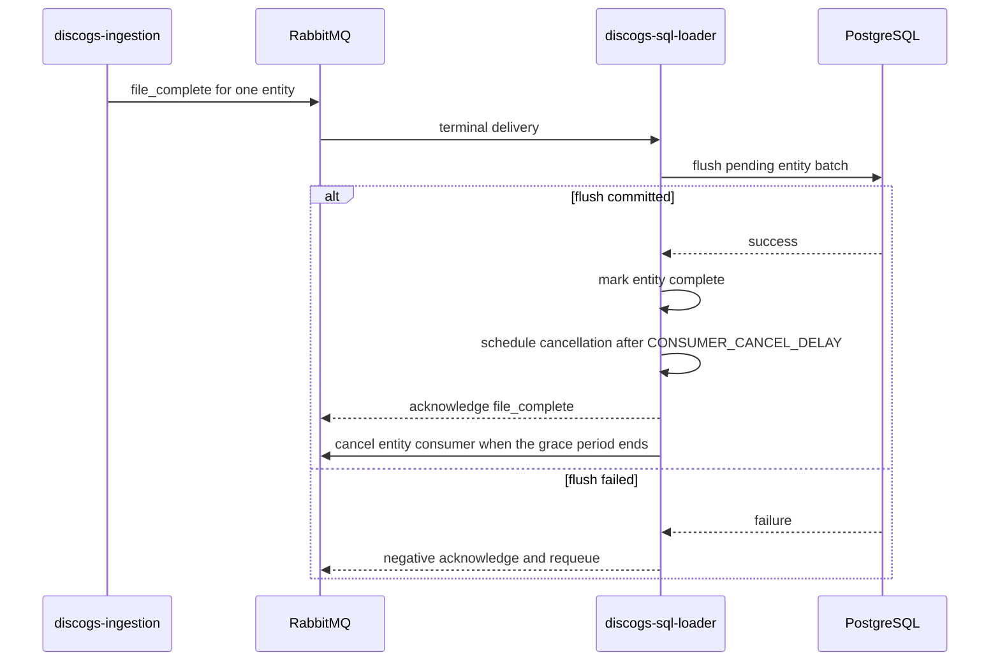

# Consumer cancellation and draining

`discogs-sql-loader` cancels a RabbitMQ consumer only after the producer signals that
its entity file is complete and the loader has drained that entity's accepted batch.



## Configuration

`CONSUMER_CANCEL_DELAY` is the grace period in seconds. The default is `300`; `0`
disables cancellation. Duplicate completion messages do not schedule duplicate tasks,
and cancellation failures are logged without preventing the remaining teardown.

Every cancellation waits for broker `cancel-ok` (`nowait=False`) with a five-second
RPC and task deadline. A type stays in `consumer_tags` until confirmation; missing
queue handles and timeouts retain the uncertain tag and mark health unhealthy.
The periodic checker then closes the uncertain delivery channel with a bounded
wait and only resubscribes after closure is confirmed. Durable pause/resubscribe
cancellations use the same deadlines.

Shutdown first cancels and joins pending grace timers. It stops attempting RPCs
on the first failed cancel and closes the uncertain channel before batch teardown,
so a broken channel cannot spend one full timeout for every remaining subscriber.
A new data record resets its type's completion marker and cancels the previous
run's grace timer. Timer cleanup removes only its own reference, so a canceled old
timer cannot erase a replacement timer. Recovery also resets completion for types
with pending messages; initially empty types reset when their first record arrives.

## Terminal signals that arrive after the cancel

The extractor publishes `extraction_complete` to every type only after the last file, so
for a long-running file the earlier types are already cancelled and the signal is queued
with no consumer. A cancelled consumer holds nothing, so the loader does not keep it
subscribed for the whole run. Instead, while a type is complete, unsubscribed, and its
`extraction_complete` is not yet settled, the periodic checker probes that queue every
`MARKER_CHECK_INTERVAL` seconds (default `5`) with a passive declare and resubscribes
only the type that holds a message. The consumer cancels again `CONSUMER_CANCEL_DELAY`
after the marker is settled, so the bound on what a consumer holds is unchanged. If the
transport is closed, the same tick runs the full queue probe.

A queued marker is therefore waiting for at most `MARKER_CHECK_INTERVAL` plus one
resubscribe. Before this, it waited for the idle reconnect, up to `QUEUE_CHECK_INTERVAL`
(one hour) after everything was idle. Because a broker-side `NO CONSUMER` is expected
for that long, `/health` lists the types in `awaiting_extraction_complete`; an operator
console should treat a queue in that list as an expected wait, not a critical state.

After every entity completes, the service closes its RabbitMQ connection. It reconnects
on the next periodic queue check when new messages are available. The interval is
controlled by `QUEUE_CHECK_INTERVAL` and defaults to one hour.

## Shutdown ordering

Process shutdown has a separate but related ordering guarantee:

1. cancel every active consumer, with broker confirmation, so no new deliveries arrive;
2. stop the durable-refresh recovery and worker tasks, the progress reporter, and the
   periodic queue checker;
3. stop the batch flush task and flush all messages already accepted by the batch
   processor;
4. cancel any pending completion grace timers;
5. close the RabbitMQ connection and confirm that every delivery callback has stopped;
6. drain the shared write admission (waits up to five seconds for in-flight callbacks and
   SQL writers);
7. close the PostgreSQL pool and release the admission budget;
8. stop the health server, then shut down telemetry so the final export includes the
   teardown metrics.

If step 5 or 6 cannot be confirmed, or closing the pool fails, the service keeps the pool
and write admission open and logs an error, rather than closing a pool that a running
callback may still use. The health server still stops. A later startup in the same process
refuses to create a second pool and budget, and fails with "previous PostgreSQL writer
lifespan did not drain". See [Shared delivery runtime](shared-delivery-runtime.md) for the
admission lifecycle.

Leaving shutdown deliveries unsettled allows the broker connection close to requeue
them once. A historical regression test exercises repeated delivery churn and verifies
that teardown never acknowledges or negative-acknowledges those late messages.

Run the focused coverage with:

```bash
uv run pytest tests/test_consumer_cancellation.py tests/test_file_completion.py tests/test_shutdown_delivery_churn.py -q
```
